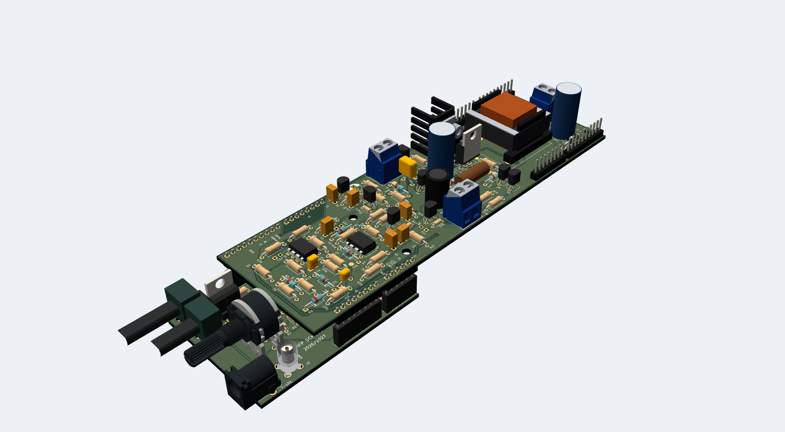

# Hi, I’m Mouaad

**Electrical engineer · Powertrain · Power electronics and electric mobility**

My path started in electrical engineering at the **National Polytechnic School of Algiers**, and I’m now continuing it at **IFP School**, in Powertrain. I’m passionate about understanding how electrical energy is converted, controlled and used—from a switching circuit to an electric machine or a complete power system.

I’m especially interested in **power electronics, electric drives and sustainable mobility**. I enjoy connecting the theory to practical engineering: developing a model, studying its behavior, choosing components, designing a PCB, and explaining why the design works the way it does.

## What I work on

### Power conversion and hardware design

My recent work connects an [analog PWM generator](https://github.com/MouaadO/analog-pwm-generator) to a [58 W synchronous buck converter](https://github.com/MouaadO/synchronous-buck-converter). The two boards combine adjustable complementary switching commands, discrete gate drivers, power conversion and measurement circuits. The converter is intended for the auxiliary electrical network of an electric scooter.

These projects bring together LTspice circuit simulation, component selection, KiCad schematics, PCB layout, routing and mechanical integration.

### Electrical machines and control

I study how machine models and control strategies translate into speed, torque, flux and voltage behavior. My projects include [induction-motor vector control](https://github.com/MouaadO/induction-motor-vector-control), [permanent-magnet generator modeling](https://github.com/MouaadO/permanent-magnet-generator), and a [winding-design application](https://github.com/MouaadO/electrical-winding-simulator) for exploring stator layouts, EMF phasors, MMF and harmonics.

### Power systems and intelligent methods

I also work on [power-flow and network analysis](https://github.com/MouaadO/power-flow-analysis), [voltage stability](https://github.com/MouaadO/voltage-stability-analysis), and [fault classification and location on the IEEE 39-bus network](https://github.com/MouaadO/power-system-fault-location-ml). The fault-location research compares electrical impedance methods with machine learning and hybrid correction. My [neural-network and genetic-algorithm implementations](https://github.com/MouaadO/neural-networks-genetic-algorithms) explore the underlying learning and optimization operations.

### Experimental power electronics

Laboratory projects on [inverter modulation](https://github.com/MouaadO/inverter-pwm-experimental-validation), a [Jones thyristor chopper](https://github.com/MouaadO/jones-thyristor-chopper), [three-phase diode rectification](https://github.com/MouaadO/three-phase-diode-rectifier), and a [thyristor rectifier supplying a DC motor](https://github.com/MouaadO/thyristor-rectifier-dc-motor) connect calculations and simulation with measured waveforms.

## Tools I use

| Area | Tools |
|---|---|
| Modeling and control | MATLAB, Simulink, Simscape Electrical |
| Circuit and PCB design | LTspice, KiCad |
| Scientific computing and machine learning | Python, NumPy, pandas, Matplotlib, scikit-learn |
| Engineering applications | PyQt5, openpyxl, PyInstaller |

Across these projects, what interests me most is the connection between **energy, control and implementation**: understanding the physical system, making the engineering choices, and turning the results into something clear and useful.
